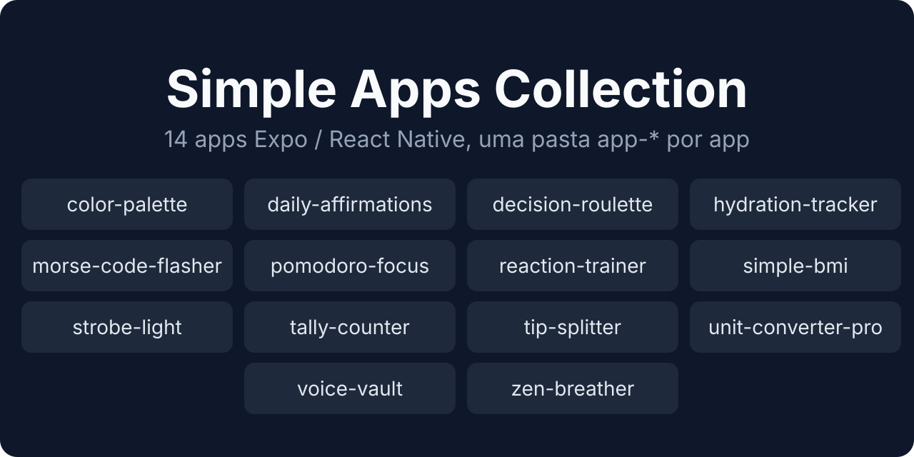
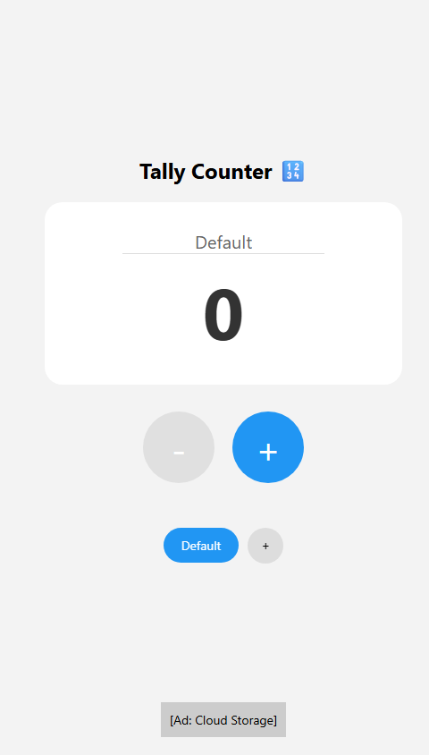
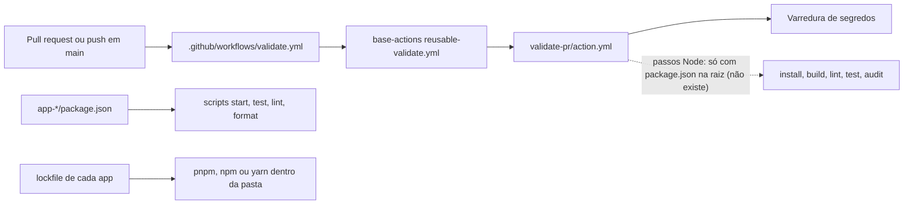

<div align="center">



# Simple Apps Collection

**Monorepositório com 14 apps móveis pequenos, cada um com uma utilidade específica, em Expo / React Native.**<br/>
Cada pasta `app-*` é independente: pasta própria, `package.json` e dependências próprias. Todo comando roda dentro da pasta do app.

[](https://expo.dev/)
[](https://reactnative.dev/)
[](https://www.typescriptlang.org/)

</div>

> Para rodar um app, entre na pasta dele: `cd app-tally-counter && pnpm install && pnpm start`. Não há `package.json` na raiz.

## Por que

Escopo: cada app faz uma coisa só, e a coleção não tem um app principal.

- **Independente.** Cada pasta tem seu `package.json`, seu lockfile (ou nenhum) e seus scripts.
- **Sem configuração.** Nenhuma variável de ambiente é exigida (ver [Configuração](#configuração)).
- **Roda no navegador.** 13 dos 14 apps têm script `web`.

## Tour

<div align="center">



<sub><b>app-tally-counter</b>, capturado do <code>expo start --web</code> em 480 px de largura.</sub>

</div>

TODO(screenshot): telas principais dos outros 13 apps. Não capturadas: exigem `pnpm web` em cada pasta (app-daily-affirmations não tem script `web`; precisa de emulador).

## Instalação e uso

### Requisitos

- Node.js 22 (o mesmo que o CI usa por padrão).
- pnpm ou npm, conforme a coluna "Gerenciador" da tabela de apps.
- Expo Go em um dispositivo, ou emulador Android/iOS, para abrir o app. `expo start --web` abre no navegador.

```bash
git clone https://github.com/juninmd/simple-apps.git
cd simple-apps/app-tally-counter   # qualquer pasta app-*
pnpm install                       # npm install em app-color-palette
pnpm start                         # expo start (também: android, ios, web)
```

## Apps

| Pasta | Descrição | Gerenciador | Scripts úteis |
|-------|-----------|-------------|---------------|
| `app-color-palette` | Gerador e explorador de paletas de cores | npm | `test` |
| `app-daily-affirmations` | Afirmações diárias positivas (React Native 0.71 puro, sem Expo SDK 54) | sem lockfile | `test`, `lint` |
| `app-decision-roulette` | Roleta para decisões aleatórias | pnpm | `test`, `lint`, `format`, `e2e` (Maestro) |
| `app-hydration-tracker` | Monitoramento de ingestão de água | sem lockfile | `start`, `android`, `ios`, `web` |
| `app-morse-code-flasher` | Conversor e piscador de código Morse | pnpm | `test`, `lint` |
| `app-pomodoro-focus` | Timer Pomodoro para foco | sem lockfile | `lint` |
| `app-reaction-trainer` | Treinador de tempo de reação | pnpm | `test`, `lint`, `format` |
| `app-simple-bmi` | Calculadora de IMC | sem lockfile | `start`, `android`, `ios`, `web` |
| `app-strobe-light` | Efeito de luz estroboscópica | yarn 1.22 (`packageManager`) | `start`, `android`, `ios`, `web` |
| `app-tally-counter` | Contador simples | pnpm | `test` |
| `app-tip-splitter` | Divisor de conta e gorjeta | pnpm | `test`, `lint` |
| `app-unit-converter-pro` | Conversor de unidades | pnpm | `test` |
| `app-voice-vault` | Gravador e armazenamento de voz | pnpm | `test` |
| `app-zen-breather` | Exercício guiado de respiração | pnpm | `test`, `lint`, `format` |

Os scripts da tabela vêm do `package.json` de cada app. Onde não há lockfile, use o gerenciador de sua preferência (o README do app indica o recomendado).

## Como funciona



- **Sem `package.json` na raiz:** o CI não instala nem testa nenhum app; a varredura de segredos é o único gate que roda no PR.
- **Lockfile por app:** nenhum lockfile fica na raiz; cada pasta usa o gerenciador que declara, e cinco delas não têm lockfile.

## Gates de CI

Só os workflows em `.github/workflows/` da raiz rodam no GitHub:

| Workflow | Quando | O que checa |
|----------|--------|-------------|
| `validate.yml` | PR e push em `main` | Reusable `juninmd/base-actions` `reusable-validate.yml` (action `validate-pr`): varredura de segredos no intervalo do PR. Os passos Node (install, build, lint, test, audit) só rodam se existir `package.json` na raiz; como não existe, **não cobrem nenhum app** |
| `security.yml` | push em `main`, semanal (domingo 00:00 UTC), manual | Reusable `reusable-security-scan.yml` do `juninmd/base-actions` |

Na prática, testes e lint dos apps não são executados pelo CI; rode-os localmente. Os workflows dentro de `app-*/.github/` (build-apk, ci, release-drafter etc.) ficam em subpastas e não são executados pelo GitHub neste repositório.

## Configuração

Nenhuma variável de ambiente é exigida pelos apps.

## Desenvolvimento

Dentro da pasta do app, apenas nos que definem o script (ver tabela de apps):

```bash
pnpm test      # jest (jest-expo)
pnpm lint      # eslint . (pomodoro-focus usa `expo lint`)
pnpm format    # prettier --write . (decision-roulette, reaction-trainer, zen-breather)
```

Não há comando de teste, lint ou build na raiz. Um build de APK/EAS não é definido nos `package.json`.

## Contribuição

Convenções para agentes e contribuidores estão em [`AGENTS.md`](AGENTS.md). Nove dos 14 apps têm `CONTRIBUTING.md` na própria pasta.

## Limitações conhecidas

- Testes e lint dos apps não rodam no CI: o gate de PR não instala nenhum app (ver [Gates de CI](#gates-de-ci)).
- Workflows em `app-*/.github/` não são executados pelo GitHub neste repositório.
- Cinco apps sem lockfile (`app-daily-affirmations`, `app-hydration-tracker`, `app-pomodoro-focus`, `app-simple-bmi`, `app-strobe-light`) instalam versões de dependências não travadas.
- `app-daily-affirmations` usa React Native 0.71 puro, fora do Expo SDK 54 dos demais apps.
- Nenhum `package.json` define script `build`. A geração de APK fica em `build-apk.yml`, dentro de cada app que o tem, e não é executada aqui.

## Licença

Este repositório não tem arquivo `LICENSE`; a licença ainda não foi definida.
