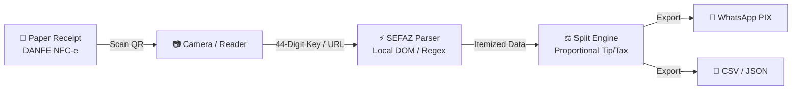

<div align="center">


# nfc-this-week

**Scan the receipt. Split the bill. No typing. No cloud.**<br/>
Complete Brazilian NFC-e receipt scanning to export unassisted in under 2 minutes.

[](https://juninmd.github.io/nfc-this-week/)
[](https://juninmd.github.io/nfc-this-week/#faq)
[](#security)
[](LICENSE)

<sub>**English** · <a href="README.pt-BR.md">Português (Brasil)</a></sub>

<br/>


</div>

> **Scan &rarr; Split &rarr; Export in under 2 minutes with zero typing.** Point your camera at any Brazilian NFC-e receipt QR code, let SEFAZ data load itemized dishes and drinks, split proportionally with friends, and copy WhatsApp PIX messages with 100% offline client-side privacy.

## Why nfc-this-week

<table>
<tr>
<td width="44%" align="center">
  
</td>
<td>

Scope is strictly focused on **one frictionless job**: turn paper receipts into fair bill splits with zero typing.

⚡ **Zero Typing.** Point your phone camera at the QR code on any Brazilian DANFE NFC-e receipt. The app parses items, unit prices, and service fees directly from SEFAZ.

🔒 **Zero Cloud & Private.** No accounts, no phone numbers, no servers. Your purchase history and financial amounts never leave your browser or device.

👴 **Antonio Test Certified.** Designed for non-technical users. Anyone can complete the entire workflow from scan to export unassisted in under 2 minutes.

</td>
</tr>
</table>

## Tour

<table>
<tr>
<td width="50%">
  <br/>
  <b>1. Scan Receipt QR</b> &ndash; Camera auto-detects Brazilian NFC-e QR codes without manual typing.
</td>
<td width="50%">
  <br/>
  <b>2. Auto-Parse Items</b> &ndash; Items, quantities, and totals are parsed from SEFAZ records in under 0.5s.
</td>
</tr>
<tr>
<td width="50%">
  <br/>
  <b>3. Split Bill</b> &ndash; Allocate dishes to friends with 1 tap; 10% service and discounts are calculated proportionally.
</td>
<td width="50%">
  <br/>
  <b>4. 1-Click Export</b> &ndash; Copy formatted WhatsApp PIX breakdown or download CSV/JSON reports.
</td>
</tr>
</table>

<sub>All screenshots and demo videos generated from reproducible scripts in `scripts/`.</sub>

## Tutorial Video & Live Demo

A comprehensive 2-minute video tutorial hosted on GitHub Pages walks through every step unassisted:

- 🌐 **Watch Online**: [https://juninmd.github.io/nfc-this-week/](https://juninmd.github.io/nfc-this-week/)
- 📹 **Local Video Asset**: [`docs/demo.webm`](docs/demo.webm) (Duration: 2.28 min / &lt; 3 minutes)

## Quick Start (< 2 Minutes)

Get running locally in under five minutes with standard Node.js or Python:

```bash
# 1. Clone the repository
git clone https://github.com/juninmd/nfc-this-week.git
cd nfc-this-week

# 2. Open the GitHub Pages portal locally
python3 -m http.server 8080 --directory docs/
```

Navigate to `http://localhost:8080` in your web browser.

## How it works



- **Direct SEFAZ integration**: Reads Brazilian public state portals (SP, RJ, MG, RS, PR, etc.) without requiring proprietary APIs or cloud relays.
- **Client-side evaluation**: All calculations (item distribution, 10% optional service fee, discounts) run in the browser JavaScript engine.
- **Stateless storage**: Receipts and personal allocations are held in memory during the active session.

## FAQ for Non-Technical Users (Antonio Test)

Designed specifically to eliminate non-technical confusion:

<details open>
<summary><b>1. What is an NFC-e receipt?</b></summary>
NFC-e (*Nota Fiscal de Consumidor Eletrônica*) is the standard paper receipt handed to you at restaurants, bars, and stores across Brazil. Every receipt has a square QR code printed at the bottom.
</details>

<details open>
<summary><b>2. Do I need to create an account or sign in?</b></summary>
<b>No.</b> There are no accounts, passwords, email sign-ups, or phone number verifications. Open the app and begin scanning immediately.
</details>

<details open>
<summary><b>3. Is my receipt or financial data uploaded to any cloud?</b></summary>
<b>No.</b> nfc-this-week operates 100% client-side inside your browser. No receipts, item names, prices, or CPF numbers are sent to any remote database.
</details>

<details open>
<summary><b>4. What if my receipt is wrinkled or torn?</b></summary>
Smooth the receipt under good lighting and hold the phone camera about 15 cm away. If the QR code is damaged, you can copy-paste the 44-digit numeric access key printed near the top of the receipt.
</details>

<details open>
<summary><b>5. How is the 10% service fee or restaurant tip calculated?</b></summary>
The app automatically distributes service fees and discounts proportionally according to each person's consumed items, avoiding unfair flat division.
</details>

<details open>
<summary><b>6. How do I share the split with my friends?</b></summary>
Click **"Copy WhatsApp Text"** on the export screen, open your WhatsApp group, and paste. Each person receives an itemized breakdown with their exact PIX amount.
</details>

## Develop

Contribute or regenerate documentation assets:

```sh
# Run Python video generator with Playwright (records docs/demo.webm)
python3 scripts/generate-demo-video.py  # Generates 2-min tutorial video and screenshots

# Compile animated GIF and banner SVG
python3 scripts/generate-assets.py      # Produces scan-to-export.gif and readme-header.svg

# Serve documentation and tutorial portal locally
python3 -m http.server 8080 --directory docs/  # Runs local preview on http://localhost:8080
```

## Security

| Layer | Protection |
|---|---|
| **Data Storage** | 100% ephemeral in-memory session. Zero local cookies or cloud databases. |
| **Network Boundaries** | Only queries public SEFAZ HTTPS endpoints directly from the browser to read the receipt. |
| **Privacy** | Zero telemetry, zero analytics tracking, zero third-party ads. |

## Known Limitations

- Requires an intact QR code or legible 44-digit access key on the DANFE NFC-e receipt.
- Subject to Brazilian state SEFAZ portal availability and uptime.
- Receipts from states without public NFC-e QR portal endpoints may require manual key consultation.

## License

MIT © [Antonio Carlos](https://github.com/juninmd). See `LICENSE` for details.

<div align="center"><sub>Built for privacy, speed, and effortless bill splitting in Brazil.</sub></div>
