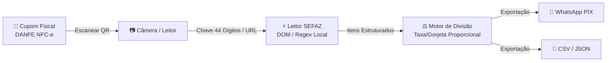

<div align="center">


# nfc-this-week

**Escaneie a nota. Divida a conta. Sem digitação. Sem nuvem.**<br/>
Fluxo completo de leitura de NFC-e até a exportação sem assistência em menos de 2 minutos.

[](https://juninmd.github.io/nfc-this-week/)
[](https://juninmd.github.io/nfc-this-week/#faq)
[](#segurança)
[](LICENSE)

<sub><a href="README.md">English</a> · **Português (Brasil)**</sub>

<br/>


</div>

> **Escanear &rarr; Dividir &rarr; Exportar em menos de 2 minutos sem digitar nada.** Aponte a câmera para o QR Code do cupom fiscal (NFC-e), deixe os dados da SEFAZ listarem os pratos e bebidas consumidos, divida proporcionalmente com os amigos e copie o resumo com chave PIX para o WhatsApp com 100% de privacidade local no navegador.

## Por que nfc-this-week

<table>
<tr>
<td width="44%" align="center">
  
</td>
<td>

O objetivo do projeto é focado estritamente em **uma tarefa sem atrito**: transformar cupons fiscais de papel em divisão justa de contas sem digitação.

⚡ **Zero Digitação.** Aponte a câmera do celular para o QR Code de qualquer cupom DANFE NFC-e. O aplicativo obtém itens, quantidades, valores e taxa de serviço diretamente da SEFAZ.

🔒 **Zero Nuvem e Privado.** Sem contas, sem senhas, sem envio para servidores. Seu histórico de compras e valores nunca saem do seu navegador.

👴 **Aprovado no Teste do Antonio.** Criado para pessoas não técnicas. Qualquer pessoa consegue escanear, conferir e exportar a divisão sem ajuda em menos de 2 minutos.

</td>
</tr>
</table>

## Tour

<table>
<tr>
<td width="50%">
  <br/>
  <b>1. Escanear Cupom NFC-e</b> &ndash; A câmera detecta o QR Code fiscal brasileiro sem digitação manual.
</td>
<td width="50%">
  <br/>
  <b>2. Leitura Automática</b> &ndash; Itens, quantidades e total são processados da SEFAZ em menos de 0,5s.
</td>
</tr>
<tr>
<td width="50%">
  <br/>
  <b>3. Dividir a Conta</b> &ndash; Distribua os itens entre amigos com 1 toque; 10% de serviço e descontos são calculados proporcionalmente.
</td>
<td width="50%">
  <br/>
  <b>4. Exportar em 1 Clique</b> &ndash; Copie o resumo formatado com chave PIX para o WhatsApp ou baixe relatórios CSV/JSON.
</td>
</tr>
</table>

<sub>Todas as capturas e vídeos foram gerados a partir de scripts reprodutíveis em `scripts/`.</sub>

## Vídeo Tutorial e Demonstração

Um vídeo tutorial de 2 minutos hospedado no GitHub Pages demonstra todo o fluxo de ponta a ponta:

- 🌐 **Assistir Online**: [https://juninmd.github.io/nfc-this-week/](https://juninmd.github.io/nfc-this-week/)
- 📹 **Arquivo de Vídeo Local**: [`docs/demo.webm`](docs/demo.webm) (Duração: 2,28 min / &lt; 3 minutos)

## Início Rápido (< 2 Minutos)

Execute localmente em menos de cinco minutos:

```bash
# 1. Clonar o repositório
git clone https://github.com/juninmd/nfc-this-week.git
cd nfc-this-week

# 2. Abrir o portal do GitHub Pages localmente
python3 -m http.server 8080 --directory docs/
```

Abra `http://localhost:8080` no navegador.

## Como funciona



- **Integração direta com a SEFAZ**: Consulta os portais públicos estaduais (SP, RJ, MG, RS, PR, etc.) sem APIs proprietárias ou servidores intermediários.
- **Processamento no cliente**: Todos os cálculos (alocação de itens, 10% de serviço opcional, descontos) ocorrem no motor JavaScript do navegador.
- **Armazenamento seguro em memória**: Os dados da conta permanecem apenas na memória durante o uso ativo da sessão.

## Perguntas Frequentes para Usuários Não Técnicos (Teste do Antonio)

Respostas diretas e sem jargões para facilitar o uso no dia a dia:

<details open>
<summary><b>1. O que é uma nota ou cupom NFC-e?</b></summary>
NFC-e (Nota Fiscal de Consumidor Eletrônica) é o cupom fiscal impresso emitido por restaurantes, bares e supermercados em todo o Brasil. Na parte inferior do papel há um QR Code quadrado.
</details>

<details open>
<summary><b>2. Preciso me cadastrar ou criar conta?</b></summary>
<b>Não.</b> Não é necessário fornecer e-mail, senha nem número de telefone. Não há login nem formulários. Basta abrir e escanear.
</details>

<details open>
<summary><b>3. Meus dados ou cupom vão para alguma nuvem?</b></summary>
<b>Não.</b> O aplicativo funciona 100% dentro do seu navegador. Nenhum cupom, lista de compras, CPF ou valor é enviado para bancos de dados externos.
</details>

<details open>
<summary><b>4. E se o cupom estiver amassado ou a câmera não ler?</b></summary>
Alise o papel em um local bem iluminado e segure a câmera a cerca de 15 cm de distância. Se o QR Code estiver rasgado, você pode digitar ou colar a chave de acesso de 44 números impressa no topo do cupom.
</details>

<details open>
<summary><b>5. Como os 10% de serviço do restaurante são calculados?</b></summary>
O aplicativo divide a taxa de serviço e eventuais descontos de forma proporcional ao consumo de cada amigo, evitando divisão injusta.
</details>

<details open>
<summary><b>6. Como envio o valor para os amigos pagarem no PIX?</b></summary>
Ao final da divisão, clique em **"Copiar Texto para WhatsApp"**, abra o grupo de amigos e cole. Cada amigo recebe a lista do que consumiu e o valor exato a transferir.
</details>

## Desenvolvimento

Para contribuir ou regenerar os ativos da documentação:

```sh
# Executar gerador de vídeo tutorial com Playwright
python3 scripts/generate-demo-video.py  # Gera vídeo de 2 minutos e capturas de tela

# Compilar GIF animado e banner do cabeçalho em SVG
python3 scripts/generate-assets.py      # Produz scan-to-export.gif e readme-header.svg

# Servir portal de documentação localmente
python3 -m http.server 8080 --directory docs/  # Executa prévia local em http://localhost:8080
```

## Segurança

| Camada | Proteção |
|---|---|
| **Armazenamento de Dados** | 100% em memória volátil durante a sessão. Sem cookies de rastreamento ou banco na nuvem. |
| **Limites de Rede** | Apenas consulta endpoints HTTPS públicos da SEFAZ para carregar o cupom. |
| **Privacidade** | Sem telemetria, sem rastreamento de anúncios, sem coleta de dados pessoais. |

## Limitações Conhecidas

- Necessita de QR Code legível ou chave de acesso de 44 dígitos no cupom DANFE NFC-e.
- Depende da estabilidade dos portais públicos das SEFAZ estaduais no momento da leitura.
- Estados cujos portais exigem certificado digital A1/A3 para consulta pública detalhada podem exigir digitação da chave de acesso.

## Licença

MIT © [Antonio Carlos](https://github.com/juninmd). Veja `LICENSE` para detalhes.

<div align="center"><sub>Construído para privacidade, rapidez e facilidade ao dividir contas no Brasil.</sub></div>
